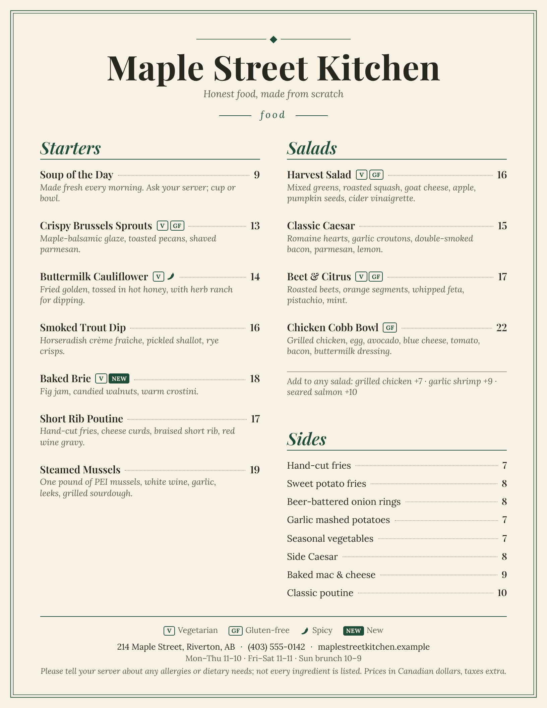
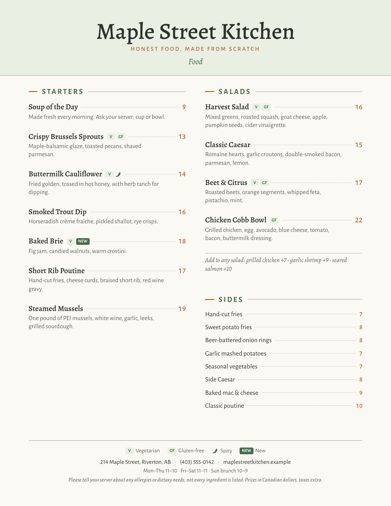
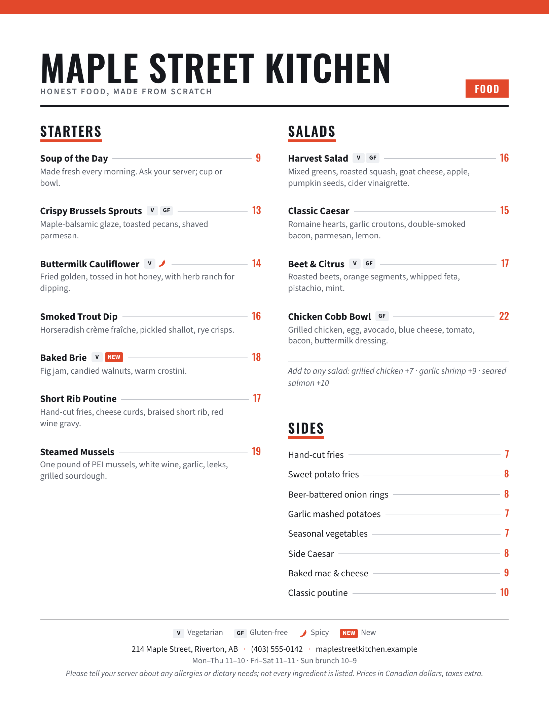
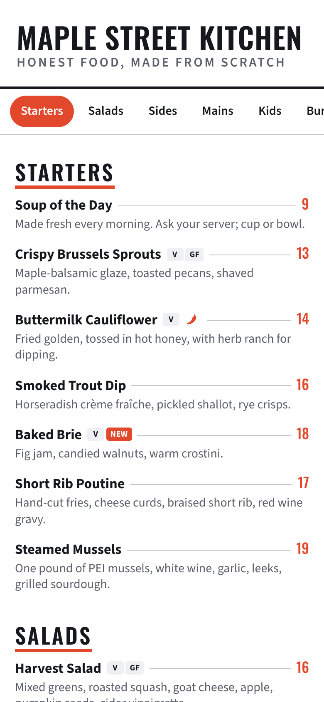

# Menu Designer

A menu template for restaurants, from Brigade Kitchen Software (makers of the
Restaurant recipe-costing program). You type your menu into one file,
`menu.json`. One command then builds:

- a **printable menu**: Letter-size (8.5 x 11 in) pages with two columns, dotted
  leaders between dish and price, dietary badges, and your address, phone and
  hours in the footer;
- a **phone / web menu**: one page that works on any phone, with section tabs
  that stay at the top as guests scroll. It works offline, so you can host it
  anywhere or put it behind a QR code.

Three themes are included (Bistro, Garden and Modern), and you can add your own.
Everything works offline: the fonts are built into each HTML file.

| Bistro | Garden | Modern | Phone |
|---|---|---|---|
|  |  |  |  |

## What you need

- **Python 3.8 or newer.** Nothing else to install for building the menus.
- **Optional, for PDF/PNG output and the fit check:** Node.js with Playwright
  and Chromium (`npm install playwright && npx playwright install chromium`).
  Without them you can still open the print HTML in a browser and print it to
  PDF yourself (choose Letter, margins "None", and turn on "Background
  graphics").

## Quick start

```bash
python3 build.py                    # menu.json, Bistro theme -> out/bistro/
python3 build.py --theme modern     # another theme
python3 build.py --theme all        # every theme in themes.json
node render.js                      # PDFs, PNGs and the fit check for everything in out/
```

`build.py` options:

| Option | Default | Meaning |
|---|---|---|
| `--menu FILE` | `menu.json` | your menu file |
| `--theme NAME` | `bistro` | a theme from `themes.json`, or `all` |
| `--themes FILE` | `themes.json` | the themes file |
| `--out DIR` | `out/<theme>/` | where to write the files |

It writes `<slug>-print.html` and `<slug>-phone.html`, where `<slug>` comes
from the restaurant name (for example `maple-street-kitchen-print.html`).

`render.js` then writes, next to each file:

- `<slug>-<theme>.pdf`: the print menu, ready for the printer;
- `<slug>-<theme>-page1.png`, `-page2.png`, ...: one image per page;
- `<slug>-<theme>-phone.png` (first screen at 390 px), `-phone-scrolled.png`
  and `-phone-full.png`.

If Playwright is installed globally, point Node at it:
`NODE_PATH=/path/to/global/node_modules node render.js`. Set `CHROMIUM_PATH` if
your Chromium is not where Playwright expects it.

### The fit check

`render.js` checks every printed page. If a page holds too much (text runs
under the footer or spills into a third column), it lists the page and section
and exits with an error, for example:

```
FIT  modern: 2 problem(s)
     - page 1: content spills into a third column (too much for two columns)
     - page 1: section "Mains" overflows (below the footer or outside the columns)
```

To fix it, move a section to another page in `pages`, add or remove
`column_break_before`, or shorten some descriptions. It also flags a section
heading that has been separated from its first dish, and checks that the phone
menu never scrolls sideways.

Pages with room to spare get a little more space between dishes, so a short
page does not end in a big empty gap. Turn this off with `"autofit_max": 0` in
`settings`.

## Editing menu.json

The file has five parts. The sample is a complete example to copy from.

```json
{
  "restaurant": { ... },
  "settings":   { ... },
  "tags":       { ... },
  "pages":      [ ... ],
  "sections":   [ ... ]
}
```

### restaurant

| Field | Example | Notes |
|---|---|---|
| `name` | `"Maple Street Kitchen"` | big title; also used for file names |
| `tagline` | `"Honest food, made from scratch"` | under the name on page 1 |
| `address` | `"214 Maple Street, Riverton, AB"` | footer |
| `phone` | `"(403) 555-0142"` | footer; tap-to-call on phones |
| `hours` | `"Mon–Thu 11–10 · Fri–Sat 11–11"` | text, or a list of lines |
| `website` | `"maplestreetkitchen.example"` | footer; a link on phones |
| `footer_note` | `"Please tell your server about any allergies..."` | small print at the bottom of every page |

Leave out any field you do not want shown.

### settings

| Field | Default | Meaning |
|---|---|---|
| `currency` | `""` | put before every price, for example `"$"`. Many menus leave it out. |
| `decimals` | `"auto"` | `"auto"`: 14 stays 14, 14.5 becomes 14.50. `"always"`: 14.00. `"never"`: round to whole numbers. |
| `language` | `"en"` | language code, for screen readers |
| `autofit_max` | `10` | most extra space (in points) added between dishes on roomy pages; `0` turns it off |

### tags

The dietary and other badges you use, with the meaning shown in the footer
legend:

```json
"tags": { "V": "Vegetarian", "VG": "Vegan", "GF": "Gluten-free", "spicy": "Spicy", "new": "New" }
```

`spicy` shows as a small chili, `new` as a filled badge, and any other tag
shows its own letters (for example `"DF": "Dairy-free"`). The legend on each
page lists only the tags used on that page.

### sections

Each section is either a list of dishes (`items`) or a simple price list
(`choices`).

```json
{
  "id": "salads",
  "title": "Salads",
  "intro": "Made to order",
  "items": [
    { "name": "Harvest Salad", "price": 16,
      "description": "Mixed greens, roasted squash, goat cheese.",
      "tags": ["V", "GF"] }
  ],
  "note": "Add grilled chicken +7"
}
```

```json
{
  "id": "sides",
  "title": "Sides",
  "choices": [
    { "name": "Hand-cut fries", "price": 7 },
    { "name": "Sweet potato fries", "price": 8 }
  ]
}
```

| Field | Meaning |
|---|---|
| `id` | short unique name used in `pages` (letters, numbers, dashes) |
| `title` | the section heading |
| `intro` | optional line under the heading |
| `note` | optional line at the end, for add-ons and swaps |
| `items` | dishes: `name`, `price`, optional `description` and `tags` |
| `choices` | price list: `name`, `price`, optional `tags` |
| `price_columns` | optional column headings for several prices per line, for example `["6 oz", "9 oz", "Btl"]`. Each `price` is then a list, such as `[11, 16, 42]`; use `""` for a size you don't sell. |
| `column_break_before` | `true` starts this section at the top of the right-hand column |
| `keep_together` | default `true`: the section is never split across columns. Set `false` for a very long section that may continue in the next column (its heading still stays with its first dish). |
| `print_only` | `true` keeps a section that is not on any page out of the phone menu |

A `price` can be a number (`14`, `14.5`), text (`"MP"` for market price), or a
list (with `price_columns`).

### pages

Says which sections go on which printed page, and in what order:

```json
"pages": [
  { "title": "Food",   "sections": ["starters", "salads", "sides"] },
  { "title": "Drinks", "sections": ["cold", "cocktails", "beer", "wine"] }
]
```

| Field | Meaning |
|---|---|
| `title` | small label under the restaurant name, such as "Food" or "Drinks" |
| `sections` | section ids, in order; the columns fill top to bottom, left then right |
| `header` | `"full"` (default for page 1) or `"compact"` (default for the rest) |
| `column_fill` | `"auto"` fills the left column first, instead of balancing the two |

The phone menu shows the sections in the same order as the pages, followed by
any section not placed on a page.

## Printing

Open the PDF and print at **100% / actual size** on Letter paper. For a
double-sided menu, print pages 1 and 2 on one sheet and 3 and 4 on another.
If you print from the HTML file in a browser instead, choose Letter, margins
"None" and turn on background graphics.

## Adding a theme

Themes live in `themes.json`. The easiest way is to copy a theme, give it a
new name, and change its colours and fonts:

```json
"harbour": {
  "label": "Harbour",
  "scheme": "light",
  "fonts": [
    { "family": "Lora", "file": "fonts/lora/Lora[wght].ttf", "weight": "400 700", "style": "normal" }
  ],
  "vars": {
    "--font-display": "'Lora', Georgia, serif",
    "--font-body": "'Lora', Georgia, serif",
    "--paper": "#f4f7fa",
    "--ink": "#1d2733",
    "--accent": "#1f5f8b"
  },
  "css": [".sec-title { border-bottom: 1pt solid var(--accent); }"]
}
```

Then run `python3 build.py --theme harbour`.

- `fonts`: the font files to build into the page. Use only fonts whose licence
  allows embedding, such as fonts under the SIL Open Font License, and keep
  each font's licence file next to it in `fonts/`.
- `vars`: colours, fonts and sizes. Copy the full list from an existing theme;
  the main ones are `--paper` (background), `--ink` (text), `--muted` (descriptions),
  `--accent` (headings and highlights), `--rule` (lines), `--leader` (dotted
  leaders), `--badge-*` (tag badges), `--mast-size` (restaurant name),
  `--sec-size` (section headings), `--name-size`, `--desc-size` and
  `--base-size` (keep descriptions at 9.5pt or more so they stay readable).
- `css`: optional extra CSS rules for decoration. Rules that start with
  `.phone` apply only to the phone menu; rules with `.page` only to print.
- `scheme`: `"light"` or `"dark"`, for the phone browser.
- `phone_dark_vars`: optional colours used on the phone menu when the guest's
  phone is in dark mode (see the Garden and Modern themes).

After a theme change, run `node render.js` again: larger fonts can make a page
overflow, and the fit check will tell you.

## Files

| File | What it is |
|---|---|
| `menu.json` | the sample menu (Maple Street Kitchen, a fictional bistro) |
| `themes.json` | the three themes |
| `build.py` | builds the print and phone HTML |
| `render.js` | makes PDFs and PNGs and runs the fit check |
| `fonts/` | the font files and their licences |
| `previews/` | sample images |
| `out/` | build output (not kept in version control) |

## Fonts and licences

All fonts are from the Google Fonts collection and are licensed under the
**SIL Open Font License 1.1** (OFL). That licence lets you use, embed and
print them freely, including in commercial menus. Each font's `OFL.txt` is in
its folder and must stay with the font files.

| Font | Used in | Folder |
|---|---|---|
| Playfair Display | Bistro | `fonts/playfairdisplay/` |
| Lora | Bistro | `fonts/lora/` |
| Alegreya | Garden | `fonts/alegreya/` |
| Alegreya Sans | Garden | `fonts/alegreyasans/` |
| Oswald | Modern | `fonts/oswald/` |
| Source Sans 3 | Modern | `fonts/sourcesans3/` |

## Copyright

Copyright (c) 2026 Matthew Neil Louis Marinier, operating as Brigade Kitchen Software. All rights reserved. The fonts in fonts/ are under the SIL Open Font License; see each OFL.txt.

See `LICENSE.txt` for what your purchase allows.
